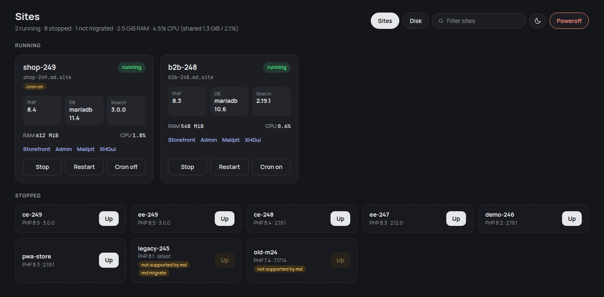

# md — Magento2 Docker local environment

`md` is a small Go CLI that runs local Magento 2 sites with plain Docker Compose and Traefik. It replaces DDEV while keeping DDEV's container names, hostnames and database volumes, so existing DDEV sites move over without changes.



## Requirements

- Linux
- Docker with Compose v2
- mkcert

## Install

Prebuilt binary, no Go needed (amd64 or arm64):

    arch=$(uname -m | sed 's/x86_64/amd64/;s/aarch64/arm64/')
    sudo curl -fsSL -o /usr/local/bin/md https://github.com/chuccv/magento2-docker/releases/latest/download/md-linux-$arch
    sudo chmod +x /usr/local/bin/md
    md --version

From source (Go 1.25+):

    go install github.com/chuccv/magento2-docker/cmd/md@latest

Update a prebuilt binary to the latest release (checks `SHA256SUMS`, replaces the running binary; use `sudo md self-update` when it lives in `/usr/local/bin`). Source builds report version `dev` and are not updated:

    md self-update

## Quickstart

    md trust                 # install the local CA once
    cd /path/to/site
    md up                    # start the site, print its URLs
    md exec <cmd>            # run a command in the web container
    md bash                  # open a bash shell in the web container
    md magento <args>        # bin/magento
    md mysql                 # mariadb client in the db container (reads stdin: gunzip -c dump.sql.gz | md mysql)
    md xhprof on|off         # profile this site in XHGui
    md xdebug on|off
    md cron on|off           # Magento cron (supercronic), saved in .md/config.yaml
    md stop                  # stop this site
    md poweroff              # stop everything, including the router
    md snapshot              # dump the database (--list, restore <file>)
    md hosts [--all]         # print /etc/hosts lines the site still needs
    md ui                    # web dashboard on 127.0.0.1:9900 (--port to change)
    md clean                 # remove unused images, build cache, volumes

Commands find the site by walking up from the current directory to `.md/config.yaml` or `.ddev/config.yaml`, then use its `name` for container names (`ddev-<name>-db` for `md mysql`). From anywhere else pass `-s <name>`, e.g. `md -s shop mysql`.

State lives in `~/.md`. Snapshots go to `~/.md/sites/<name>/snapshots/`.

## Setting up a site

Pick the command by what the folder already has:

| Folder | Command |
|---|---|
| Empty | `md install [dir] --version 2.4.8` |
| Has `.ddev/config.yaml` | `md migrate [dir]` |
| Has Magento code, no `.md/config.yaml` | `md init [dir]` |

Never write `.md/config.yaml` by hand for a new site; these commands pick the stack and run the checks.

### md install

Installs a fresh Magento into an empty folder: composer create-project, `setup:install`, base URL, search prefix. See [Install stacks](#install-stacks) for the versions it picks.

### md migrate

Reads `.ddev/config.yaml`, writes `.md/config.yaml`, pins the search version, takes a `pre-migrate` DB snapshot and starts the site. `.ddev/` is never written. The site keeps `<name>.ddev.site` as its base URL.

### md init

For a folder that already has Magento code, e.g. a customer repo plus a DB dump:

1. Reads the Magento version and edition from `composer.lock` (`--version` when there is no lock).
2. Picks PHP, database and search from the stack; the same flags as `md install` override it: `--php`, `--db`, `--db-type`, `--search`, `--search-engine`, `--varnish`.
3. Writes `.md/config.yaml` and runs `up`. If `up` fails, the config and containers are removed again.
4. Checks the domain: adds missing `/etc/hosts` lines (with `sudo` on a terminal, otherwise prints the command), then fetches `https://<name>.<domain>/` and prints the status. A domain problem does not stop the containers.

It never runs composer or `setup:install` and never touches `app/etc/env.php`. When `env.php` is missing it prints the next steps:

```bash
gunzip -c dump.sql.gz | md mysql
md magento setup:config:set --db-host=db --db-name=db --db-user=db --db-password=db \
  --session-save=redis --session-save-redis-host=redis --session-save-redis-db=2 \
  --cache-backend=redis --cache-backend-redis-server=redis --cache-backend-redis-db=0 \
  --page-cache=redis --page-cache-redis-server=redis --page-cache-redis-db=1
md magento setup:store-config:set --base-url=https://<name>.<domain>/ --base-url-secure=https://<name>.<domain>/ --use-secure=1 --use-secure-admin=1
md magento config:set catalog/search/engine opensearch
md magento config:set catalog/search/opensearch_server_hostname opensearch
md magento config:set catalog/search/opensearch_server_port 9200
md magento setup:upgrade
```

A site is working only once its https URL answers; a running container is not enough.

## Domains

Every site answers on three names:

| Host | Role |
|---|---|
| `<name>.<domain>` | base URL for sites made by `md install` / `md init` |
| `<name>.md.site` | alias (also the default `<domain>`) |
| `<name>.ddev.site` | alias; base URL for sites migrated from DDEV |

Plus `additional_hostnames` (as `<host>.<domain>`) and `additional_fqdns` from the site config.

- `*.ddev.site` has public DNS pointing to 127.0.0.1, no setup needed.
- `md.site` has no public DNS: each name needs a line in `/etc/hosts` (`md hosts --all | sudo tee -a /etc/hosts`).
- To avoid `/etc/hosts`, set `domain:` to a domain you own with a wildcard record `A * -> 127.0.0.1` (DNS only, not proxied). Names that have their own record, e.g. a Cloudflare Tunnel subdomain, keep working because a specific record wins over the wildcard; just don't name a site like one of them.
- `md up` warns on stderr when a site name does not resolve to 127.0.0.1.

## Configuration

`~/.md/config.yaml`, all keys optional:

    ports:
      http: 80
      https: 443
      mailpit_http: 8025
      mailpit_https: 8026
      xhgui_http: 8143
      xhgui_https: 8142
      phpmyadmin_http: 8036
      phpmyadmin_https: 8037
    bind_all_interfaces: false   # true publishes router ports on 0.0.0.0, default is 127.0.0.1
    domain: md.site              # main domain, sites answer on <name>.<domain>

After changing `domain`, each site picks it up on its next `md up` / `md restart`. Base URLs stored in a site's database are not changed.

## Cron

- `md cron on|off` runs `bin/magento cron:run` every minute with supercronic inside the web container. Off by default.
- It saves `cron: true` in `.md/config.yaml` (run `md migrate` first on a DDEV-only site), so it survives `md stop` / `md up`. A running site is switched live, no restart.

## Profiling

- `md xhprof on` enables XHProf in that site's web container only and prints the XHGui URL (`https://<host>:8142`). No restart: php-fpm reloads.
- It is off by default and off again after `md stop` / `md restart`, which recreate the container.
- Only web requests are profiled; `bin/magento` and cron are not.
- One XHGui serves every site. Filter runs by the Server Name field (the request host) or the URL field. Use Compare to diff two runs.
- Built-in PHP functions are not recorded (`NO_BUILTINS`). To count SQL queries look at the calls of `Zend_Db_Statement::execute`; add it as a Watch Function to see it on every run.
- Profiling slows requests down; compare runs with each other, not with production.

## MCP server

`md mcp` serves an MCP server over stdio so Claude Code can drive md and Magento sites.

    claude mcp add -s user m2-docker -- md mcp

The server sends instructions with the setup rules above (install / migrate / `site_init`, no hand-written config, a site only counts as working once its URL answers). Every tool except `sites_list` and `site_init` takes the site name as `site`. Output is capped at about 20 KB.

- `sites_list`, `site_describe`
- `site_init` (`dir`, optional `version`, `php`, `db`, `db_type`, `search`, `search_engine`, `varnish`); never runs sudo, missing `/etc/hosts` lines come back as an error with the command for the user
- `site_up`, `site_stop`, `site_restart`
- `magento` (`args`), `exec` (`cmd`, run with `bash -lc`), `sql` (`query`, writes allowed)
- `logs` (`file`: `exception`, `system`, `debug` or `report` with `id`; `lines`, `grep`)
- `snapshot_create`, `snapshot_list`, `snapshot_restore`
- `xdebug`, `xhprof` (`on`; xhprof returns the XHGui URL)
- `cron` (`on`; persisted in `.md/config.yaml`)

There are no tools for `clean`, `poweroff`, `install` or `migrate`.

## Install stacks

`md install` and `md init` pick PHP, database, search, Redis, Varnish and Node from `stacks.yaml`, keyed by Magento version line. An exact key such as `"2.4.7-p5"` overrides its line. Defaults are embedded in the binary (`internal/install/stacks.yaml`); an entry in `~/.md/stacks.yaml` replaces the embedded one with the same key, and new keys are added. A missing file is fine, a malformed one is an error.

```yaml
"2.4.8":
  php: "8.4"
  database: {type: mariadb, version: "11.4"}
  search: {engine: opensearch, version: "2.19.1"}
  redis: "7.2"
  varnish: "7.6"
  node: "22"
```

Flags override the stack: `--php`, `--db`, `--db-type mariadb|mysql`, `--search`, `--search-engine opensearch|elasticsearch` (needs `--search <version>`), and `--varnish` (off by default, uses the stack's Varnish version). The choices are written to `.md/config.yaml`, and `setup:install` gets the matching search flags (`opensearch`, `elasticsearch7` or `elasticsearch8`).

## Supported

- Web server: nginx-fpm or apache-fpm, PHP 8.1 to 8.5
- Database: MariaDB or MySQL
- Search: OpenSearch or Elasticsearch
- Redis, Varnish, phpMyAdmin, Node, Mailpit, Xdebug, XHProf
- Not supported: RabbitMQ, custom DDEV compose files (`md migrate --ignore-extra-compose` skips them)

## How it works

md is one static Go binary. It writes plain Docker Compose files and lets Docker do the rest; there is no daemon of its own.

| Piece | What md uses | Why |
|---|---|---|
| CLI | Go, cobra | single binary, no runtime |
| Orchestration | `docker compose` v2, one project per site (`md-<name>`) plus `md-shared` | stock tooling, easy to inspect with `docker compose ls` |
| Routing | one Traefik v3 container (`md-router`) with a file-provider dynamic config | one router for every site, hostnames go to the right web container |
| TLS | mkcert local CA, one certificate covering all site hostnames | green padlock in browsers and Playwright |
| Web image | `md/php:<version>` built locally from an embedded Dockerfile, shared by every site on that PHP version; nginx or apache, php-fpm and Mailpit run under tini | one image per PHP version instead of one per site |
| Image rebuilds | the image carries a hash label of its build context; `md up` rebuilds only when the hash changes and prunes the old image | upgrades apply on the next `md up` |
| Database | official `mariadb`/`mysql` images, one container per site, data in the site's `<name>-mariadb` volume | sites can pin different versions; DDEV volumes are reused without copying |
| Search | one shared OpenSearch/Elasticsearch container per version (`md-opensearch-<v>`, OpenSearch heap 768 MB, Elasticsearch 512 MB, a pinned version from the Magento stack (never `latest`), started with the first site that needs it and stopped with the last one), each site gets its own index prefix, set once by `md install`, `md migrate` or the first `md up` of an installed site | one JVM instead of one per site |
| Node | the official `node:<major>-slim` files copied once into a `md-node-<major>` volume, mounted read-only into web containers | no Node install in the PHP image |
| Profiling | XHProf with perftools/php-profiler, one shared XHGui container (SQLite) | see [Profiling](#profiling) |
| Snapshots | `mariadb-dump`/`mysqldump` piped through gzip to `~/.md/sites/<name>/snapshots/` | restore takes a pre-restore snapshot first |
| Config | `.md/config.yaml` in the site, written by `md install`, `md init` or `md migrate` | `.ddev/` is never written |
| Magento settings | `bin/magento config:set --lock-env` for base URLs and search prefix | changes land in `env.php`, not the database |
| GUI | `md ui`: stdlib HTTP server with embedded HTML/JS, live stats over Server-Sent Events from one shared `docker stats` and `docker events` stream | loopback only, actions need a custom header |
| AI | `md mcp`: MCP server over stdio using the official Go SDK | lets an assistant run md and Magento commands |

Containers use `restart: "no"`: nothing starts on boot, run `md up` when you need a site.

## Compatibility with DDEV

- Container names stay `ddev-<name>-web`, `ddev-<name>-db`, `ddev-<name>-redis`
- `<name>.ddev.site` keeps working, see [Domains](#domains)
- Existing `<name>-mariadb` volumes are reused as-is
- md refuses to start while DDEV containers for the same site, or the DDEV router on the same ports, are running
